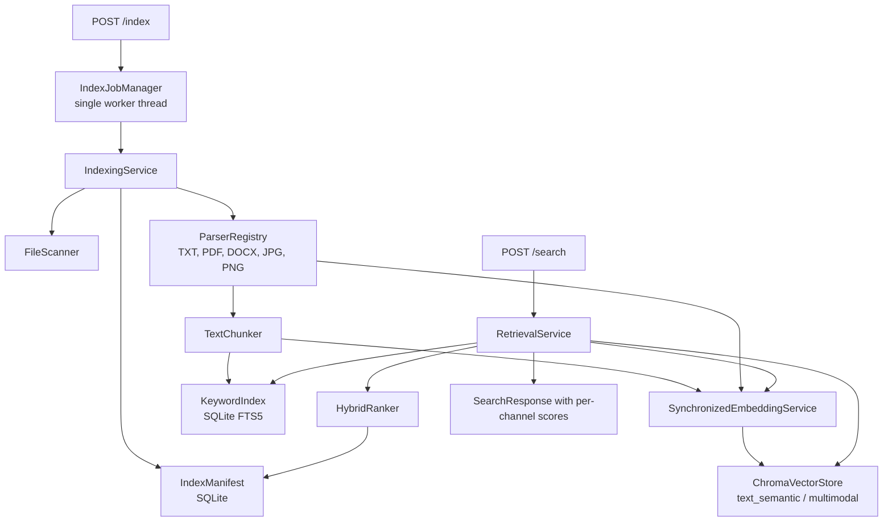

# Week 4 — Vector Storage, Hybrid Ranking and Retrieval MVP

**Status:** Complete

## 1. Objective

Week 4 connects the Week 2 ingestion layer and the Week 3 embedding engine into a working end-to-end retrieval pipeline:

```text
folder -> scan -> stat/hash -> parse -> chunk -> embed -> Chroma + FTS5 -> hybrid ranking -> HTTP API
```

## 2. Implemented Scope

- DOCX parsing with `python-docx` (no Java runtime, no first-run download)
- JPG/PNG validation through `ImageParser`, so images enter the same pipeline
- Page-aware, overlapping text chunking sized for the 128-token BERT input
- Persistent Chroma storage, one collection per embedding space and model
- SQLite FTS5 keyword index with BM25 scoring, including CJK text
- SQLite manifest for incremental indexing (new, changed, unchanged, deleted, duplicate)
- Explainable hybrid ranking (weighted min-max or reciprocal rank fusion)
- Search filters: file extension, folder prefix, modification date
- Background indexing jobs with progress reporting
- FastAPI endpoints for indexing, job status, index status, readiness and search
- Retrieval benchmark tooling for Natural Questions and COCO subsets

## 3. Architecture



### New modules

| Module | Responsibility |
| --- | --- |
| `services/parsers/docx_parser.py` | Paragraph and table text from DOCX files |
| `services/parsers/image_parser.py` | Validates decodable JPG/PNG images |
| `services/text_units.py` | Word / CJK-character splitting shared by chunking and FTS |
| `services/chunking/text_chunker.py` | Page-aware overlapping chunks with character offsets |
| `services/storage/vector_store.py` | `VectorStore` protocol and `ChromaVectorStore` |
| `services/storage/keyword_index.py` | FTS5 BM25 keyword channel |
| `services/storage/manifest.py` | Path -> content-hash state for incremental indexing |
| `services/indexing/indexing_service.py` | Synchronizes folders with the indexes |
| `services/indexing/job_manager.py` | Runs index/remove jobs on one background worker |
| `services/retrieval/ranking.py` | Explainable hybrid fusion |
| `services/retrieval/retrieval_service.py` | Query validation, channels, filters, results |
| `services/embeddings/synchronized.py` | Serializes access to LiteRT interpreters |
| `services/evaluation/` | Metrics, dataset preparation and benchmark runner |
| `config.py`, `container.py` | Settings from `OLR_*` variables and service wiring |
| `api/schemas.py`, `main.py` | HTTP contract |

## 4. Key Design Decisions

### 4.1 Chunking

BERT accepts 128 WordPiece tokens. Chunks contain at most 80 units (words, or single CJK characters) with a 20-unit overlap, which leaves headroom for subword splitting. PDF chunks never cross a page boundary, so each hit reports a page number.

### 4.2 Separate embedding spaces

Each collection is named `<space>__<model_id>` and stores `embedding_space`, `model_id` and `dimension` in its metadata. `ChromaVectorStore` rejects any vector whose space, model or dimension does not match, so BERT and MobileCLIP vectors are never compared. Changing a model creates a new collection instead of mixing vectors.

Similarity is computed as the dot product of the L2-normalized query and stored vectors, which is the cosine similarity regardless of the index distance function.

### 4.3 Keyword channel

Chroma filters on substrings but does not score lexical relevance, so the keyword channel uses SQLite FTS5 and `bm25()`. File names are weighted 2x relative to body text, which also makes images searchable by name. CJK characters are space-separated before indexing so Chinese phrases match. Every query term is quoted, so user input cannot inject FTS5 operators.

### 4.4 Incremental indexing

| Situation | Action |
| --- | --- |
| Same size and mtime as manifest | Skip without hashing |
| Touched but same SHA-256 | Refresh manifest only |
| Content already indexed via another path | Reuse vectors (duplicate) |
| New or changed content | Parse, chunk, embed, write, then record |
| File deleted from an indexed folder | Remove manifest row; purge vectors when no path references them |
| Folder missing (e.g. unmounted drive) | Report an error and keep the index |

The manifest is written last, so a file whose embedding or storage write fails is retried on the next run.

### 4.5 Hybrid ranking

Channels: `keyword` (BM25), `text_semantic` (MiniLM), `image_semantic` (MobileCLIP text-to-image).

1. Chunk hits are collapsed to the best chunk per document and channel.
2. Each channel score is normalized to 0..1. Three methods are available through `OLR_FUSION_METHOD`:
   - `calibrated` (default since Week 5): absolute scores. Keyword = fraction of the query's content words found in the passage or file name; semantic = cosine similarity mapped linearly from a per-model range (MiniLM 0.10–0.60, MobileCLIP 0.10–0.30) and clipped. Ties are broken by raw scores such as BM25.
   - `weighted`: min-max scaling within each channel's candidates (the Week 4 default).
   - `rrf`: `1 / (k + rank)`, scaled so rank 1 scores 1.0.
3. `score = Σ weight × normalized / Σ weights of requested channels that can score this document kind`.

Default weights are keyword 0.3, text semantic 0.7, image semantic 0.7. Text documents and images are therefore both scored on a 0..1 scale. Every result returns the raw score, normalized score, weight, contribution and rank for each channel.

Why calibration became the default: Week 5 UI testing on `sample_data` (two relevant text files and one unrelated photo) showed that min-max scaling gave the relevant PDF 0% because it was the lower of two text candidates, and gave the unrelated photo 70% because it was the only image. Calibrated scores do not depend on which other documents were retrieved, so the displayed "% match" is meaningful. A regression test reproduces this case.

### 4.6 Concurrency and privacy

- One worker thread performs all index writes.
- `SynchronizedEmbeddingService` prevents concurrent LiteRT invocations from search and indexing.
- Chroma is opened with `anonymized_telemetry=False`; a test asserts it.
- The API binds to `127.0.0.1` in the documented run command.

## 5. HTTP API

| Method | Path | Purpose |
| --- | --- | --- |
| GET | `/health/live` | Liveness; never loads models |
| GET | `/health/ready` | Model and storage status (`ready` / `degraded`, or 503) |
| POST | `/index` | `{"directory": "..."}` -> 202 with a job |
| POST | `/index/remove` | Forget a folder -> 202 with a job |
| GET | `/index/jobs/{job_id}` | Job state, progress and report |
| GET | `/index/status` | Roots, file counts, vector counts, active job |
| POST | `/search` | Hybrid search |

Search request:

```json
{
  "query": "accessibility budget",
  "top_k": 10,
  "modes": ["keyword", "text_semantic", "image_semantic"],
  "extensions": ["pdf", "docx"],
  "path_prefix": "/Users/me/Documents/work",
  "modified_after": "2026-01-01T00:00:00Z"
}
```

Each result contains `document_id`, `kind`, `file_name`, `extension`, `paths` (all copies of identical content), `score`, `channel_scores`, `snippet`, `page_number` and `chunk_id`.

## 6. Testing

### 6.1 Install the new dependency

```bash
source .venv/bin/activate
python -m pip install -r backend/requirements.lock   # adds python-docx and lxml
```

### 6.2 Full regression suite

```bash
PYTHONPATH=backend python -m pytest backend/tests -v \
  --cov=app.services \
  --cov-report=term-missing \
  --cov-fail-under=85
```

`test_real_models_e2e.py` is skipped automatically when the model files are absent.

### 6.3 Test map

| Test file | What it verifies |
| --- | --- |
| `test_text_units.py`, `test_text_chunker.py` | Unit splitting, overlap, page boundaries, CJK, offsets |
| `test_docx_parser.py`, `test_image_parser.py` | Valid, empty, corrupted, truncated and permission cases |
| `test_parser_registry.py` | New extensions registered; unknown ones rejected |
| `test_keyword_index.py` | BM25 order, file-name search, Chinese phrases, filters, injection safety, persistence |
| `test_index_manifest.py` | Path-boundary prefix queries, grouping, summary, persistence |
| `test_vector_store_contract.py` | Model/space/dimension contract and error wrapping (no Chroma needed) |
| `test_chroma_vector_store.py` | Real Chroma: cosine scores, isolation, filters, delete, persistence, telemetry off |
| `test_indexing_service.py` | Incremental runs, modifications, deletions, duplicates, failures, retries, removal |
| `test_hybrid_ranker.py` | Collapsing, weighted and RRF fusion, cross-kind scale, explanations |
| `test_retrieval_service.py` | Hybrid, text-to-image, duplicates, filters, degraded channels, validation |
| `test_job_manager.py` | Progress, failures, serialization, history |
| `test_search_api.py` | HTTP flow: index -> poll -> status -> search -> remove; validation; 503 |
| `test_pipeline_e2e.py` | Real Chroma + SQLite + parsers end to end, restart persistence |
| `test_retrieval_metrics.py`, `test_evaluation_datasets.py` | Metrics, NQ/COCO preparation, benchmark runner |
| `test_real_models_e2e.py` | Real BERT + MobileCLIP over `sample_data` |

### 6.4 Real-model smoke test

```bash
PYTHONPATH=backend python -m pytest backend/tests/test_real_models_e2e.py -v
```

### 6.5 Manual API check

```bash
python -m uvicorn app.main:app --app-dir backend --host 127.0.0.1 --port 8765

curl -s http://127.0.0.1:8765/health/ready
curl -s -X POST http://127.0.0.1:8765/index \
  -H 'Content-Type: application/json' \
  -d "{\"directory\": \"$PWD/sample_data\"}"
curl -s http://127.0.0.1:8765/index/jobs/<job_id>
curl -s http://127.0.0.1:8765/index/status
curl -s -X POST http://127.0.0.1:8765/search \
  -H 'Content-Type: application/json' \
  -d '{"query": "process local documents without the cloud", "top_k": 5}'
```

Interactive documentation is available at `http://127.0.0.1:8765/docs`.

### 6.6 Offline check

Disable Wi-Fi (or block network access for the Python process), restart the service, index a folder and search. The workflow must behave identically.

### 6.7 Results

| Environment | Tests | Coverage (`app.services`) |
| --- | --- | --- |
| Windows 11, Python 3.11, real MiniLM + MobileCLIP models | 205 passed, 0 skipped | 96.19% |

## 7. Text Embedding Model Replacement

The first real-model end-to-end test showed that the Week 3 text model, MediaPipe `bert_embedder`, could not rank a tomato-soup recipe above an unrelated document for the query "how do I make tomato soup". `tools/diagnose_text_embeddings.py` isolated the cause:

| Check | MediaPipe `bert_embedder` | MobileCLIP text encoder | all-MiniLM-L6-v2 (adopted) |
| --- | ---: | ---: | ---: |
| Related > unrelated (5 sentence triples) | 3 / 5 | 5 / 5 | 5 / 5 |
| Mean margin (related − unrelated cosine) | −0.062 | 0.318 | 0.669 |
| Highest unrelated-pair cosine | 0.903 | 0.610 | 0.085 |
| Project vectors vs MediaPipe `TextEmbedder` | cosine 1.0000 | — | — |

The project's tokenization and tensor mapping reproduce MediaPipe exactly, so the defect is the model: it exposes the raw BERT pooler output, which is not trained for sentence similarity (for example, "Where are my tax documents?" scored 0.903 against a football sentence and 0.487 against a tax-return sentence).

The text-semantic channel therefore uses **all-MiniLM-L6-v2**, a distilled BERT-architecture sentence-embedding model. It uses the same uncased WordPiece vocabulary, so the existing tokenizer is reused. The exported graph performs masking, mean pooling and L2 normalization and outputs 384 dimensions. Because the model ID changed, Chroma creates a new `text_semantic__all_minilm_l6_v2_float32_v1` collection; vectors from the old model are never compared with the new ones. Re-indexing is required after the switch.

## 8. Model Assets

Model files are not stored in Git. To provision them on a new machine:

| Assets | How to obtain |
| --- | --- |
| `minilm_l6_text.tflite`, `minilm_l6_vocab.txt` | Run `tools/convert_minilm_l6.ipynb` in Google Colab; it exports the model with `litert-torch`, checks tokenizer and LiteRT/sentence-transformers parity, and repeats the five semantic checks |
| `mobileclip_s0_text.tflite`, `mobileclip_s0_image.tflite`, `mobileclip_s0_tokenizer.json` | Run `tools/convert_mobileclip_s0.ipynb` in Google Colab; it converts Apple's MobileCLIP-S0 checkpoint and checks LiteRT/PyTorch parity |
| `bert_text_embedder.tflite`, `bert_vocab.txt` (optional, legacy) | `python tools/fetch_bert_model.py`; only needed to rerun the MediaPipe comparison |

Then run `python tools/verify_models.py`, which reports checksums, loads every backend and runs a smoke inference. Rebuilt files can have different checksums from earlier builds because converter versions differ; the parity checks in the notebooks and `test_real_models_e2e.py` are the acceptance criteria.

## 9. Retrieval Benchmark

```bash
# Natural Questions (BEIR packaging). corpus.jsonl[.gz] and queries.jsonl[.gz] from
# huggingface.co/datasets/BeIR/nq at revision ed7edb11ab8c173ff4394c30ff266c7297904b24
# (later revisions store Parquet), qrels/test.tsv from huggingface.co/datasets/BeIR/nq-qrels
python evaluation/prepare_nq_subset.py --beir-dir ~/datasets/beir/nq \
  --out evaluation/data/nq --num-queries 300 --num-distractors 2000
python evaluation/run_retrieval_benchmark.py --dataset evaluation/data/nq

# COCO 2017 validation captions and images
python evaluation/prepare_coco_subset.py \
  --annotations ~/datasets/coco/annotations/captions_val2017.json \
  --images ~/datasets/coco/val2017 --out evaluation/data/coco --num-images 500
python evaluation/run_retrieval_benchmark.py --dataset evaluation/data/coco
```

Results are written to `evaluation/results/<dataset>.json` and `.md`. Each run indexes into a cleared `evaluation/runs/<dataset>/` folder, and the query-embedding cache is reset before every mode set so that latencies include query inference.

### 9.1 Text retrieval: Natural Questions subset

300 NQ test questions; corpus of 2,361 passages (all relevant passages plus 2,000 random distractors from the 2.68M-passage BEIR corpus). Indexing took 101.7 s (23 passages/s) on a laptop CPU.

| Modes | Recall@1 | Recall@5 | Recall@10 | MRR |
| --- | ---: | ---: | ---: | ---: |
| keyword (BM25) | 0.759 | 0.936 | 0.964 | 0.890 |
| text_semantic (MiniLM) | 0.869 | 0.997 | 1.000 | 0.978 |
| **keyword + text_semantic (hybrid)** | **0.876** | **1.000** | **1.000** | **0.984** |

- Hybrid ranking is best on every metric. These numbers were measured with the Week 4 `weighted` (min-max) fusion; see the Week 5 notes for the calibrated default.
- Semantic retrieval improves Recall@1 by 11 points over BM25: NQ questions and answer passages often use different wording.

### 9.2 Text-to-image retrieval: COCO subset

500 randomly sampled COCO val2017 images; one human caption per image is the query and the image is the only relevant item. Indexing took 39.0 s (13 images/s).

| Modes | Recall@1 | Recall@5 | Recall@10 | MRR |
| --- | ---: | ---: | ---: | ---: |
| image_semantic (MobileCLIP-S0) | 0.674 | 0.922 | 0.974 | 0.779 |
| image_semantic + keyword | 0.674 | 0.922 | 0.974 | 0.779 |

- COCO file names are numeric, so the keyword channel finds nothing. The identical scores confirm that applicable-weight normalization does not penalize images when the keyword channel is empty.

### 9.3 Interpretation and limits

- These are small subsets with random distractors, which are easier than the full benchmarks. The numbers support relative comparisons between modes on this system; they are not comparable with published full-corpus BEIR or COCO 5K results.
- Query latency (p50/p95) and peak memory are reported in `evaluation/results/*.md`. Runs before the cache-reset fix reused cached query embeddings in later mode sets and under-reported their latency.

## 10. Known Limitations

- Calibration ranges are fixed per model; they come from sentence-pair diagnostics (MiniLM) and typical CLIP similarity ranges (MobileCLIP) and should be revisited if a model changes.
- Folder and date filters are applied after candidate retrieval (5x `top_k`), so very selective filters may return fewer than `top_k` results.
- Scanned PDFs without a text layer are indexed by file name only; OCR is out of scope.
- Deleting a document from the FTS5 table scans the table; acceptable for personal libraries, revisit for very large ones.
- MobileCLIP still embeds one image per interpreter call (see Week 3).
